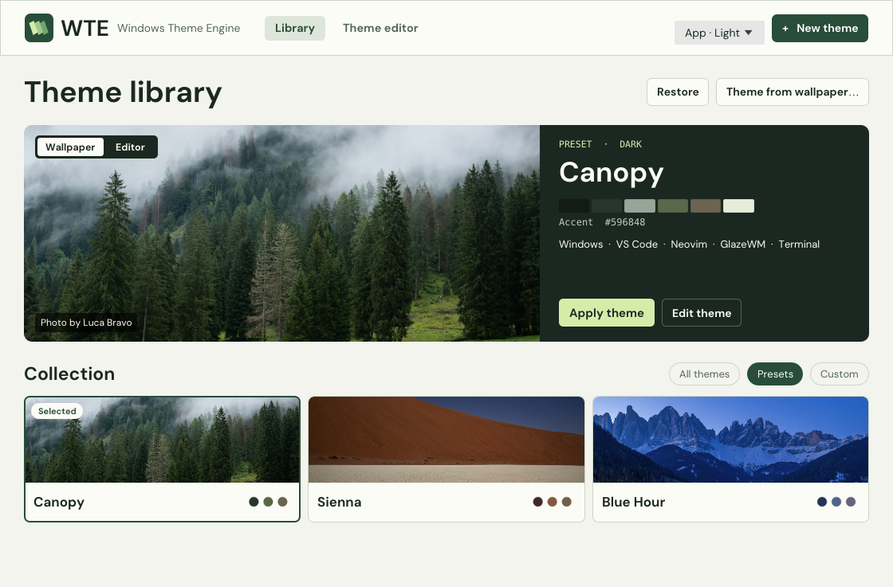
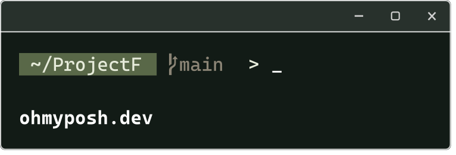
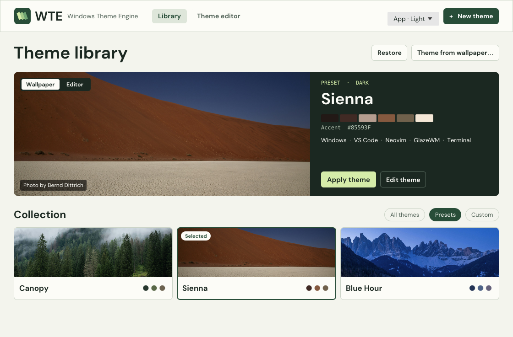
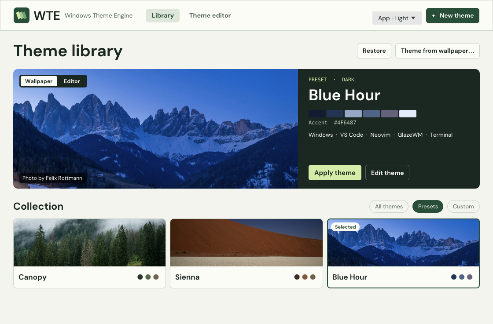
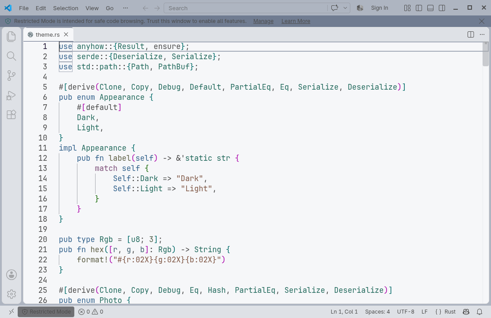
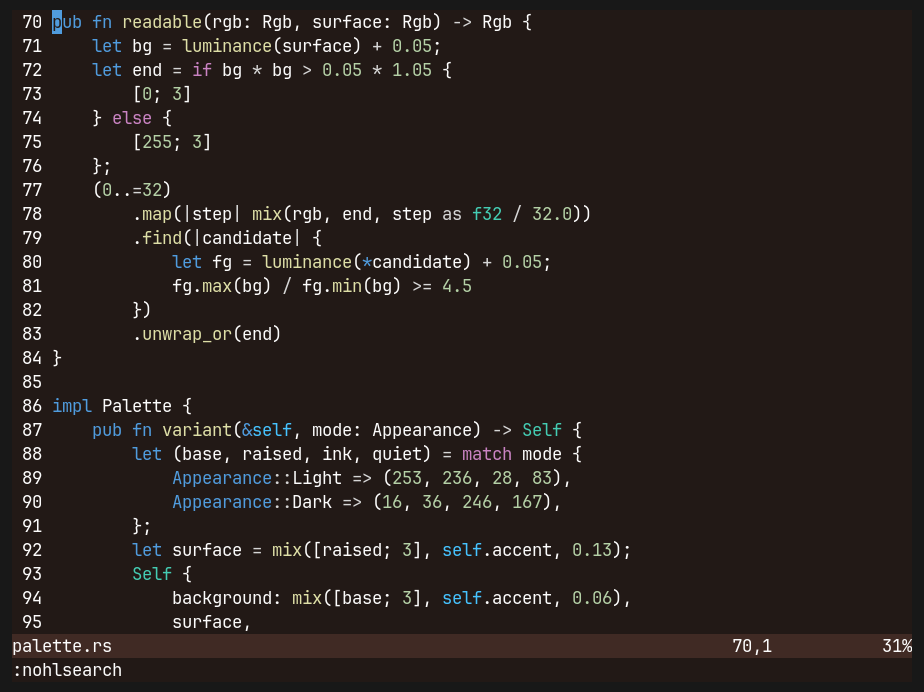
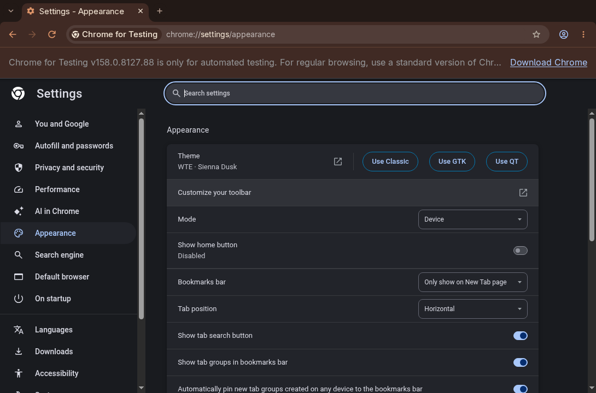
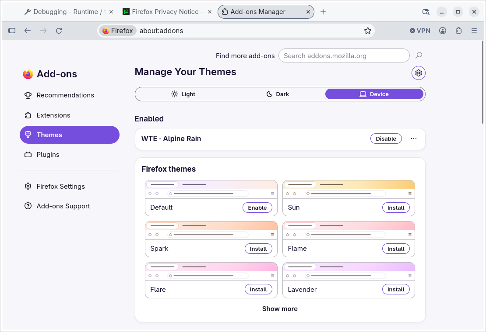
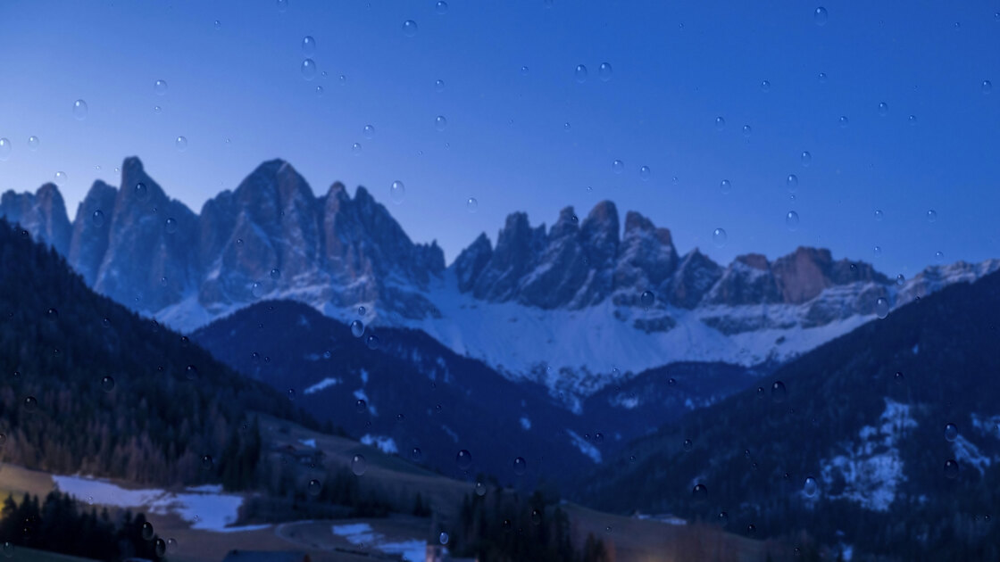

# WTE · Windows Theme Engine

WTE is a portable Rust app for Windows 11. Apply one palette across your wallpaper, Windows appearance, VS Code, Neovim, Windows Terminal and GlazeWM borders. Export a matching Oh My Posh prompt and themes for Chrome and Firefox. Start from one of three bundled presets or let WTE pick an accent and build a theme from a photograph. VS Code and Neovim share ExoVoid syntax colors in both modes, with darker ink for light backgrounds.

[Run the portable app](#run-the-portable-app) · [Build from source](#build-from-source) · [Apply a preset](#apply-a-preset) · [Restore previous settings](#restore-previous-settings) · [Create a custom theme](#create-a-custom-theme) · [Browser setup](#load-a-browser-theme) · [Screenshots](#screenshot-gallery)



## Run the portable app

Extract `WTE-0.5.0-windows-x64.zip` and double-click `wte.exe`. WTE opens in **Library**. Choose **App · Light** or **App · Dark** in the top bar to change the WTE window immediately. It remembers this preference when you reopen it. Each integration is optional. The apply results identify any enabled integration WTE could not find.

## Build from source

### On Windows

1. Install Microsoft’s C++ Build Tools. In Visual Studio Installer, select **Desktop development with C++** and include the MSVC x64 build tools and a Windows SDK. [Microsoft installation guide](https://learn.microsoft.com/en-us/cpp/build/vscpp-step-0-installation?view=msvc-170)
2. Install stable Rust using the **x64** Windows installer and choose the default MSVC toolchain. [Rust installer](https://rust-lang.org/tools/install/)
3. Open a new PowerShell window in the source directory containing `Cargo.toml`. Build and launch the release executable with the following commands.

```powershell
cargo build --release --locked
.\target\release\wte.exe
```

### From Linux for Windows x64

Install the MinGW-w64 x86-64 toolchain and make its `x86_64-w64-mingw32-gcc`, `x86_64-w64-mingw32-windres` and `x86_64-w64-mingw32-ar` commands available on `PATH`. From the repository root, run the following commands.

```sh
rustup target add x86_64-pc-windows-gnu
cargo build --release --locked --target x86_64-pc-windows-gnu
```

Copy `target/x86_64-pc-windows-gnu/release/wte.exe` to the Windows machine. The executable includes the preset wallpapers and fonts.

### Run the tests

Run `cargo test --locked` from the repository root. With `nvim` on `PATH`, `cargo test --locked -- --include-ignored` also checks startup and focus-triggered colorscheme changes in a temporary Neovim profile.

## Apply a preset

| Preset | Wallpaper | Palette |
| --- | --- | --- |
| Canopy | Mist over a pine forest in Falcade, Italy | Pine, sage and warm ivory |
| Sienna | A red dune in Deadvlei, Namibia | Clay, copper and sand |
| Blue Hour | The Dolomites above St. Magdalena at dusk | Midnight blue, periwinkle and ice |

1. In **Library**, select a card in **Collection**. Switch between **Wallpaper** and **Editor** in the preview to see the photograph and a code sample in the selected palette.
2. Select **Apply theme**. WTE asks Windows to select the new desktop theme and checks the active theme. If Windows still needs a selection, **Apply results** gives the exact name to choose in Personalization.
3. Read **Apply results** for each enabled component. Restart open Neovim sessions after the first application. If GlazeWM reports that it saved the colors and requests a reload, use your GlazeWM reload binding or restart it.

## Create a custom theme

1. In **Library**, choose **Theme from wallpaper…** and pick a local JPEG or PNG up to 40 megapixels. The native Windows file picker accepts a selection or **Cancel**. WTE reads the image in the background and opens an editable draft named after the file. It samples visible pixels locally, groups similar hues, and selects a prominent accent and a supporting color. Grayscale photos produce neutral palettes. WTE adjusts the extracted colors for contrast against the selected surfaces.
2. To start from a preset instead, select its card and choose **New theme**. In the editor, **Choose local image…** replaces the wallpaper. **Use wallpaper colors** regenerates the six swatches from the selected image, including bundled wallpapers. You can tweak each swatch and rename the draft before saving.
3. In **Color palette → Theme mode**, choose **Light** or **Dark** for this theme. Switching back restores the swatches you edited in that mode. **Use wallpaper colors** rebuilds both palettes from the photo. Dark themes use deeper accent and secondary swatches. WTE updates these two swatches in older dark palettes on upgrade. You can still edit their colors by hand.
4. Adjust **Blur**, **Raindrops** and **Film grain** while watching the preview. The *Alpine Rain* example uses the Blue Hour photograph with blur at **8%**, raindrops at **74%** and film grain at **6%**. The effects render into a still wallpaper, so you can close WTE after applying it.
5. **Accent** supplies the Windows accent and focused GlazeWM border. **Surface** supplies the unfocused border. Clear **Use palette** beside either border to choose its color independently.
6. Under **Components**, select the applications to update. Leave the editor theme fields blank for ExoVoid syntax with wallpaper-based backgrounds, highlights and borders. Enter an installed VS Code theme or Neovim colorscheme name to use that editor's own theme.


Choose **Save theme** to copy the imported wallpaper to the local library and return to the collection. Under **Collection**, select **Custom** to find it again. The **Editor** preview shows how the colors read together. Select **Apply theme** when you want to update your setup.


## What WTE changes

| Component | Interface and scope |
| --- | --- |
| Windows desktop | WTE installs a local `.theme` in the current user’s Windows Themes folder and opens it through the registered shell handler. It checks whether Windows activated it. If selection is pending, WTE applies the wallpaper directly with `IDesktopWallpaper`. Windows controls confirmation for the full accent and appearance change. [Windows wallpaper API](https://learn.microsoft.com/en-us/windows/win32/api/shobjidl_core/nf-shobjidl_core-idesktopwallpaper-setwallpaper) · [Microsoft theme file format](https://learn.microsoft.com/en-us/windows/win32/controls/themesfileformat-overview) |
| VS Code | WTE edits the default stable profile at `%APPDATA%\Code\User\settings.json`. Dark themes use **ExoVoid Classic Syntax - Dark Soft Blue**. Light themes use **WTE ExoVoid Light**, which keeps the same TextMate scopes, semantic token rules and font styles, and darkens the foreground colors. WTE scopes the palette overrides to the selected base. WTE preserves comments, unrelated settings and other theme scopes. Named profiles, workspace settings and automatic theme selection can take precedence. [VS Code theme settings](https://code.visualstudio.com/docs/configure/themes) |
| Neovim | WTE asks the installed Neovim for its config and data directories. If the executable is missing, it looks for an existing profile in Local and Roaming AppData, including `NVIM_APPNAME` and XDG overrides. It writes the colorscheme and its loader under `stdpath('data')/site/pack/wte/start/wte` and adds `after/plugin/wte-theme-engine.lua` under `stdpath('config')` for plugin managers such as lazy.nvim. Classic highlights, Tree-sitter captures and LSP token groups use colors from the same ExoVoid theme. After the initial restart, changes load on startup or when the frontend delivers `FocusGained`. [Neovim packages](https://neovim.io/doc/user/pack/) |
| GlazeWM v3 | WTE edits the colors of the focused and unfocused borders in `%USERPROFILE%\.glzr\glazewm\config.yaml` or the absolute path in `GLAZEWM_CONFIG_PATH`. The existing border enablement, tile gaps and window rules are preserved. When colors change, WTE requests a reload and redraw through the GlazeWM CLI. Border effects require Windows 11. [GlazeWM configuration](https://github.com/glzr-io/glazewm#config-window-effects) |
| Windows Terminal | WTE updates the named color scheme, profile defaults and explicit profile color overrides in existing Stable, Preview, Canary and unpackaged settings. It preserves JSONC comments. Presets include Terminal colors. Themes saved before 0.5 can opt in from the editor. [Windows Terminal settings paths](https://learn.microsoft.com/en-us/windows/terminal/faq#where-can-i-find-the-settings-file) |
| Oh My Posh | Exports a local prompt with a path, Git branch and command marker. Its stable filename lets the same shell profile follow subsequent WTE themes. [Oh My Posh configuration](https://ohmyposh.dev/docs/installation/customize) |
| Chrome | Exports a Manifest V3 theme folder with colors for the frame, toolbar, tabs, address bar and new tab page. [Chrome theme format](https://developer.chrome.com/docs/extensions/develop/ui/themes) |
| Firefox | Exports a static WebExtension theme as a single XPI with colors for the frame, toolbar, tabs, address bar and new tab page. It declares the theme’s light or dark color scheme. [Firefox theme format](https://developer.mozilla.org/en-US/docs/Mozilla/Add-ons/WebExtensions/manifest.json/theme) |

### First use with VS Code

On **Apply theme**, WTE checks for the selected ExoVoid base. If needed, it passes the bundled upstream 1.4.0 VSIX for dark mode, or a locally generated WTE ExoVoid Light VSIX for light mode, to VS Code’s extension manager. Both packages are declarative and work offline. If WTE cannot find the CLI, **Apply results** shows the local file to select with **Extensions: Install from VSIX…**. Organization extension policies apply. A named editor override skips this installation step.

## Fit a tiled Windows Terminal

If Neovim and lazygit both leave a strip inside the right window border, choose **Edit theme → Components → Fit terminal to tiled windows**, then **Save theme → Apply theme**. Open a fresh Terminal window with the affected profile. This option removes Terminal padding, hides the scrollbar and turns off character-grid snapping. It also updates padding and scrollbar overrides on individual profiles and fills missing default font metrics from the startup profile. This covers a known difference between the profile used to size a new window and the defaults used by directly launched console programs. [Terminal startup sizing discussion](https://github.com/microsoft/terminal/issues/18872)

**Windows Terminal colors** can be switched independently. **Library → Restore** recovers the previous settings. [Terminal profile appearance](https://learn.microsoft.com/en-us/windows/terminal/customize-settings/profile-appearance) · [Terminal resize settings](https://learn.microsoft.com/en-us/windows/terminal/customize-settings/interaction#snap-window-resizing-to-character-grid)

To narrow down a remaining strip, compare a new floating Terminal window with the same profile tiled in GlazeWM. In PowerShell, `[Console]::WindowWidth` reports the number of columns available to an application. A difference between the two windows helps distinguish a tiling issue from a Terminal profile setting.

## Use the Oh My Posh prompt

Enable **Oh My Posh prompt** in the theme editor, save and apply. **Apply results → Copy path** gives the generated configuration. To connect an existing PowerShell setup once, wrap the Oh My Posh initialization in your PowerShell profile as shown below. Put your current initialization line in the `else` branch so Restore brings your usual prompt back. If your current line uses a named theme or a custom path, keep those arguments in that branch.

```powershell
$wtePrompt = Join-Path $env:LOCALAPPDATA 'WTE\prompt\wte.omp.json'
if (Test-Path -LiteralPath $wtePrompt) {
    oh-my-posh init pwsh --config $wtePrompt | Invoke-Expression
} else {
    oh-my-posh init pwsh | Invoke-Expression
}
```



Open a new shell after applying a theme. WTE writes the local prompt file. Your shell profile controls initialization. Other supported shells can use the same file with their usual `--config` option. [Oh My Posh shell setup](https://ohmyposh.dev/docs/installation/customize)

## Load a browser theme

To add a browser to a preset, choose **Edit theme** to make a custom copy. In the editor, enable **Chrome**, **Firefox**, or both under **Components**. Choose **Save theme**, then **Apply theme** in the library. **Apply results → Copy path** gives you the exact folder or file for each browser. Browser components start turned off, including when opening older libraries.

- **Chrome.** Open `chrome://extensions`. If your organization permits it, enable **Developer mode**, choose **Load unpacked** and select the exported **chrome** folder. Check **Settings → Appearance → Theme** for the WTE theme name. [Chrome’s local installation guide](https://developer.chrome.com/docs/extensions/get-started/tutorial/hello-world#load-unpacked)
- **Firefox.** Open `about:debugging#/runtime/this-firefox`, choose **Load Temporary Add-on** and select **firefox.xpi**. Check **Add-ons and themes → Themes** for the enabled theme. A temporary theme lasts until Firefox restarts. Lasting installation in standard Firefox requires a Mozilla-signed package. [Firefox temporary installation](https://extensionworkshop.com/documentation/develop/temporary-installation-in-firefox/) · [Mozilla signing and distribution](https://extensionworkshop.com/documentation/publish/signing-and-distribution-overview/)

WTE keeps each theme’s exports under `%LOCALAPPDATA%\WTE\browsers\wte-<theme-id>\`. After changing a theme, apply it in WTE and load its updated export in the browser. Each browser controls activation. Chrome uses its own appearance setting for internal pages such as Settings. The exports contain a color manifest and request no permissions.

## Restore previous settings

Choose **Library → Restore → Restore settings**. WTE remembers each component immediately before its first change and keeps that restore point across theme switches and app restarts. After a successful restore, the next apply starts a new restore point. Your WTE theme library and imported pictures stay available.

| Component | What to expect after Restore |
| --- | --- |
| Windows desktop | WTE opens a saved copy of your previous desktop theme, through Windows Personalization. It restores the wallpaper, accent and appearance mode, and reapplies separately assigned monitor wallpapers. |
| Windows Terminal, VS Code and GlazeWM | WTE restores the original config files byte for byte and removes a settings file it created. It asks VS Code to uninstall any theme extension it installed. Reload the editor window. WTE requests a GlazeWM reload when the CLI is available. |
| Neovim | WTE restores existing files and removes the package files and startup hook it added. Restart Neovim. To check the detected profile, compare the paths in **Apply results** with `:echo stdpath('config')` and `:echo stdpath('data')`. |
| Oh My Posh | WTE restores the prior contents of the exported prompt file, or removes it if WTE created it. With the conditional setup above, the next shell uses your previous initialization. |
| Chrome and Firefox | WTE restores the exported files. If you activated a theme in the browser, reselect your previous theme in Chrome’s **Appearance** settings or Firefox’s **Add-ons and themes**. |

WTE stores its restore point under `%LOCALAPPDATA%\WTE`. If you edited a file after applying a theme, Restore saves its current contents under `backups\restore-<id>\` before replacing it. **Restore results** lists the backup location and any component that needs another attempt. You can run Restore again after resolving an error.

Full restore points begin with version 0.4. WTE can also recover the earliest available VS Code backup from an older release and a GlazeWM backup when its other settings match the current profile. Earlier releases did not capture the original desktop or Neovim state.

WTE runs with the current user’s privileges. It works offline without a service, scheduled task, startup entry, direct registry edits or editor extension downloads. The portable build is unsigned. An organization’s application-control policy may require an approved or signed build. The repository includes the Rust source, dependency lockfile and Windows privilege manifest for review.

## Credits

ExoVoid is by GinoPioLoco and uses the MIT license. WTE bundles the published 1.4.0 extension. Its Dark Soft Blue JSON matches the pinned source. [Theme source](https://github.com/gpioloco/ExoVoid/blob/58413770f8575c8835073f6d769c9951f46bbe55/themes/ExoVoidClassicSyntax_DarkSoftBlue.json) · [Extension listing](https://marketplace.visualstudio.com/items?itemName=GinoPioLoco.exovoid) · [ExoVoid license](assets/exovoid/LICENSE)

The bundled photographs use the Unsplash License. The UI uses DM Sans under the SIL Open Font License. [Wallpaper credits](assets/wallpapers/CREDITS.md) · [Unsplash License](https://unsplash.com/license) · [DM Sans license](assets/fonts/OFL.txt)

## Screenshot gallery

The WTE screenshots show the Windows build running under Wine. The component screenshots show the generated themes loaded in isolated Linux application profiles. Select a thumbnail to open it at full size.

| Sienna preset | Blue Hour preset |
| --- | --- |
| [](docs/screenshots/preset-sienna.png) | [](docs/screenshots/preset-blue-hour.png) |

| VS Code · Alpine Rain, light | Neovim · Sienna Dusk, dark |
| --- | --- |
| [](docs/screenshots/vscode-light.png) | [](docs/screenshots/neovim-dark.png) |

| Google Chrome for Testing · Sienna Dusk | Firefox · Alpine Rain |
| --- | --- |
| [](docs/screenshots/chrome-dark.png) | [](docs/screenshots/firefox-light.png) |

The Alpine Rain desktop theme points Windows to this rendered wallpaper, shown here at reduced resolution.


