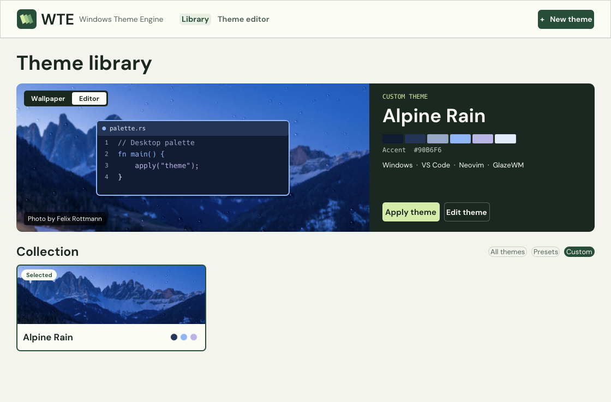

# WTE · Windows Theme Engine

WTE is a portable Rust app for Windows 11. Apply one palette across your wallpaper, Windows accent, VS Code, Neovim and GlazeWM borders. The three bundled presets work offline, and the theme editor lets you create your own.

[Run the portable app](#run-the-portable-app) · [Build from source](#build-from-source) · [Apply a preset](#apply-a-preset) · [Create a custom theme](#create-a-custom-theme)


## Run the portable app

Extract `WTE-0.1.0-windows-x64.zip` and double-click `wte.exe`. WTE opens in **Library**. VS Code, Neovim and GlazeWM are optional. The apply results identify any enabled integration WTE could not find.

## Build from source

### On Windows

1. Install Microsoft’s C++ Build Tools. In Visual Studio Installer, select **Desktop development with C++** and include the MSVC x64 build tools and a Windows SDK. [Microsoft installation guide](https://learn.microsoft.com/en-us/cpp/build/vscpp-step-0-installation?view=msvc-170)
2. Install stable Rust using the **x64** Windows installer and choose the default MSVC toolchain. [Rust installer](https://rust-lang.org/tools/install/)
3. Open a new PowerShell window in the source directory containing `Cargo.toml`. Build and launch the release executable with the following commands.

```powershell
cargo build --release --locked
.\target\release\wte.exe
```

### From Linux for Windows x64

Install the MinGW-w64 x86-64 toolchain and make its `x86_64-w64-mingw32-gcc`, `x86_64-w64-mingw32-windres` and `x86_64-w64-mingw32-ar` commands available on `PATH`. From the repository root, run the following commands.

```sh
rustup target add x86_64-pc-windows-gnu
cargo build --release --locked --target x86_64-pc-windows-gnu
```

Copy `target/x86_64-pc-windows-gnu/release/wte.exe` to the Windows machine. The executable includes the preset wallpapers and fonts.

### Run the tests

Run `cargo test --locked` from the repository root. With `nvim` on `PATH`, `cargo test --locked -- --include-ignored` also checks startup and focus-triggered colorscheme changes in a temporary Neovim profile.

## Apply a preset

| Preset | Wallpaper | Palette |
| --- | --- | --- |
| Canopy | Mist over a pine forest in Falcade, Italy | Pine, sage and warm ivory |
| Sienna | A red dune in Deadvlei, Namibia | Clay, copper and sand |
| Blue Hour | The Dolomites above St. Magdalena at dusk | Midnight blue, periwinkle and ice |

1. In **Library**, select a card in **Collection**. Switch between **Wallpaper** and **Editor** in the preview to see the photograph and a code sample in the selected palette.
2. Select **Apply theme**. Windows may open Personalization to finish the desktop change.
3. Read **Apply results** for each enabled component. Restart open Neovim sessions after the first application. If GlazeWM reports that it saved the colors and requests a reload, use your GlazeWM reload binding or restart it.

## Create a custom theme

1. Select a starting theme and choose **New theme**. **Edit theme** also creates a copy when you start from a preset. On a saved custom theme, **Edit theme** updates that entry.
2. Enter a **Theme name** and choose a wallpaper. **Choose local image…** accepts JPEG or PNG images up to 40 megapixels. WTE copies an imported image into its library when you save.
3. Adjust **Blur**, **Raindrops** and **Film grain** while watching the preview. To reproduce *Alpine Rain* below, start with **Blue Hour** and set blur to **8%**, raindrops to **74%** and film grain to **6%**. WTE renders the effects into a still image, so you can close the app after applying it.
4. Click a swatch in **Color palette** to edit it. **Accent** supplies the Windows accent and the focused GlazeWM border. **Surface** supplies the unfocused border. Clear **Use palette** beside either border to choose its color independently.
5. Under **Components**, choose which applications WTE should update. Leave the VS Code and Neovim theme fields blank to use the palette, or enter the name of a theme already installed in that editor.


Choose **Save theme** to return to the library. Under **Collection**, select **Custom** to find it again. The **Editor** preview shows how the colors read together. Select **Apply theme** when you want to update your setup.



## What WTE changes

| Component | Interface and scope |
| --- | --- |
| Windows desktop | WTE opens a local `.theme` file through the registered Windows shell handler. The file specifies a fill-mode wallpaper and an explicit accent color. Personalization and organizational policy control the final desktop appearance. [Microsoft theme file format](https://learn.microsoft.com/en-us/windows/win32/controls/themesfileformat-overview) |
| VS Code | WTE edits the default stable profile at `%APPDATA%\Code\User\settings.json`. Generated palettes use scoped workbench, syntax and semantic colors on the bundled Monokai theme. WTE preserves comments, unrelated keys and other theme scopes. Named profiles, workspace settings and automatic theme selection can take precedence. [VS Code theme settings](https://code.visualstudio.com/docs/configure/themes) |
| Neovim | WTE writes a colorscheme, selection file and Vimscript loader under `stdpath('data')/site/pack/wte/start/wte`. After the initial restart, changes load on startup or when the frontend delivers `FocusGained`. [Neovim packages](https://neovim.io/doc/user/pack/) |
| GlazeWM v3 | WTE updates the enabled flag and color for focused and unfocused borders in `%USERPROFILE%\.glzr\glazewm\config.yaml` or the absolute path in `GLAZEWM_CONFIG_PATH`. It requests a reload through the CLI for a standard Program Files installation. Border effects require Windows 11. [GlazeWM configuration](https://github.com/glzr-io/glazewm#config-window-effects) |

## Backups and recovery

WTE stores its library, imported photos, rendered wallpapers and desktop themes in `%LOCALAPPDATA%\WTE`. Before changing an existing VS Code or GlazeWM configuration, it saves the original bytes in `backups\<apply-id>\` under that folder. **Apply results** shows the backup path. WTE replaces each file atomically and reports each integration independently.

- **Windows** — Select your previous theme in Windows Personalization before deleting any WTE wallpaper files.
- **VS Code and GlazeWM** — Restore the relevant `vscode-settings.json` or `glazewm-config.yaml` backup to its original configuration path, then reload the application. If you edited the file after applying the theme, merge the settings you want to keep.
- **Neovim** — Remove `site/pack/wte/start/wte` under `stdpath('data')` and restart Neovim. Run `:echo stdpath('data')` in Neovim to locate that directory.

WTE runs with the current user’s privileges. It works offline without a service, scheduled task, startup entry, direct registry edits or editor extension downloads. The portable build is unsigned. An organization’s application-control policy may require an approved or signed build. The repository includes the Rust source, dependency lockfile and Windows privilege manifest for review.

## Credits

The bundled photographs use the Unsplash License. The UI uses DM Sans under the SIL Open Font License. [Wallpaper credits](assets/wallpapers/CREDITS.md) · [Unsplash License](https://unsplash.com/license) · [DM Sans license](assets/fonts/OFL.txt)
